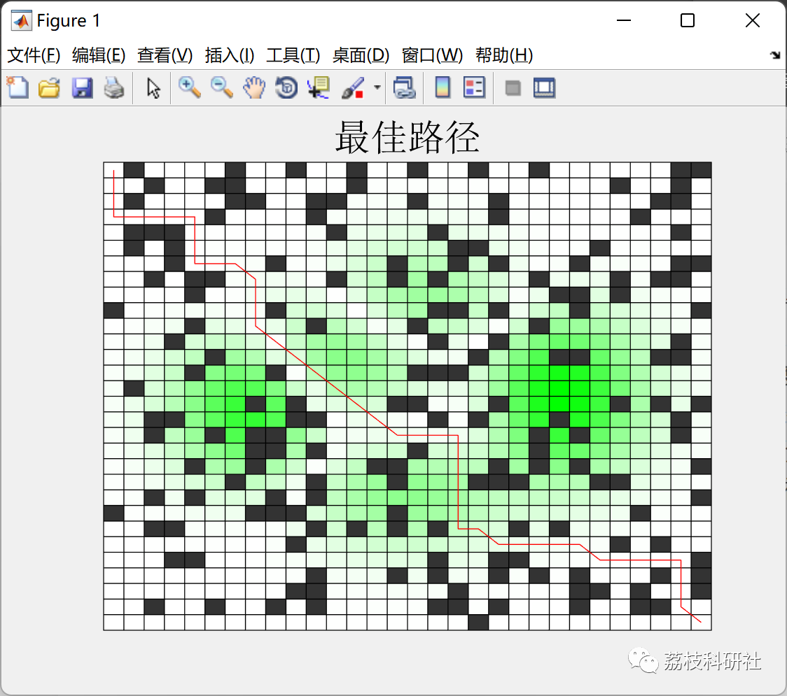
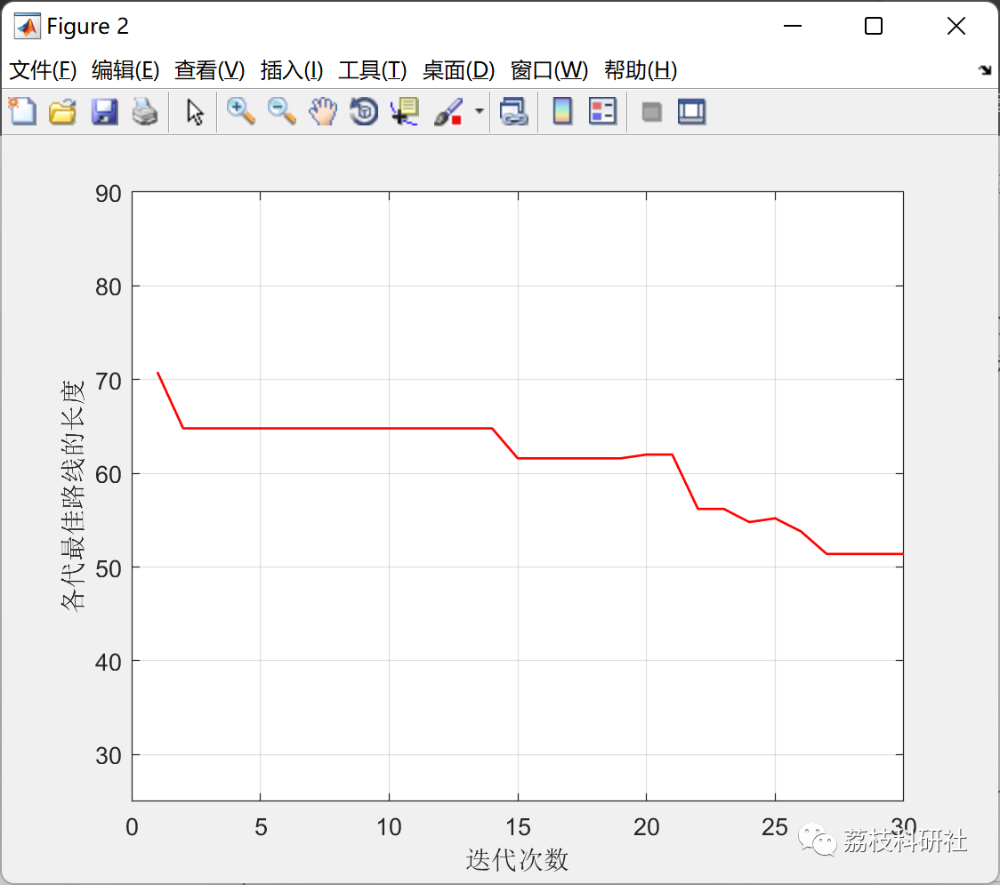
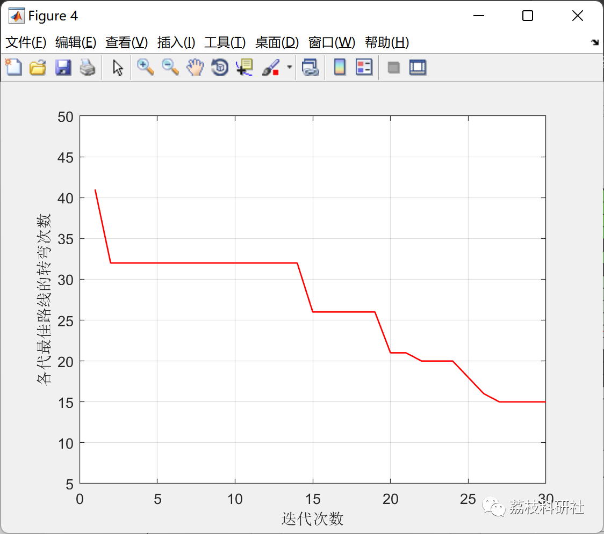
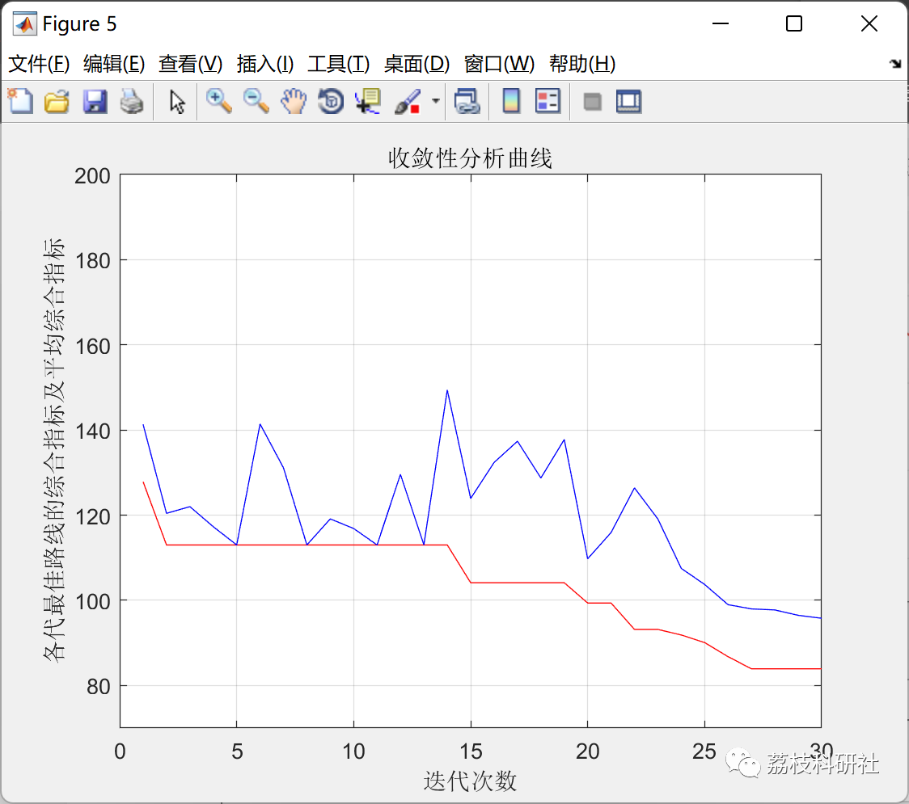

# Research on Path Planning of Mobile Robots with Multi-Factor Ant Colony Algorithm (Matlab Code Implementation)

💥💥💥💞💞💞 Welcome to this blog❤️❤️❤️ 💥💥💥
🏆 Bloggers' Advantage: 🌞🌞🌞 The content of the blog strives for rigorous thinking and clear logic, making it convenient for readers.
⛳️ Mantra: A journey of a thousand miles is begun with a single step.
Litchi Research Society
Code Collection: Power Systems, Intelligent Algorithms and Applications, Neural Network Prediction, Path Planning, Optimized Scheduling, Workshop Scheduling, Image Processing, Signal Processing...
🎁 Special Section Link:
🌈🌈🌈🌟🌟🌟🌟 Electrical Code Drone and Physical Applications Path Planning Intelligent Algorithms and Their Applications Optimized Scheduling Neural Network Prediction Workshop Scheduling Image Processing Romantic Her Signal Processing Mathematical Modelling My Philosophical Thoughts Voice Processing Complete Code Issues
💥1 Literature Reading
📚2 Overview
The above improved algorithms mostly focus on improving the search efficiency of ant colony algorithms, achieving as short a path as possible, but have not been researched in other optimal factors of the path. Based on the research of predecessors, this paper proposes a multi-factor ant colony algorithm, using three kinds of heuristic information: distance, number of turns, and slope size, to enable ants to find suitable grids based on multiple types of information, making the search path show optimal performance on the basis of comprehensively considering various factors. Furthermore, combined with a multi-factor information pheromone update model, the quality of each feasible path is evaluated comprehensively, and information pheromones are assigned. Then, combined with the improved grid map modeling method, the non-uniform initial information pheromone accelerates the convergence of the algorithm, which can achieve better results.
🎉3 Running Results
👨‍💻4 Matlab Code Realization
Click the article's lower left corner [Read Full Content]

## Images

<!-- PAYMENT_BLOCK -->

## Get this dataset

- Payment link (Stripe): [Buy now](https://buy.stripe.com/3cs8yP7sY87d0vu9AB)
- Payment QR code: 

<!-- /PAYMENT_BLOCK -->
